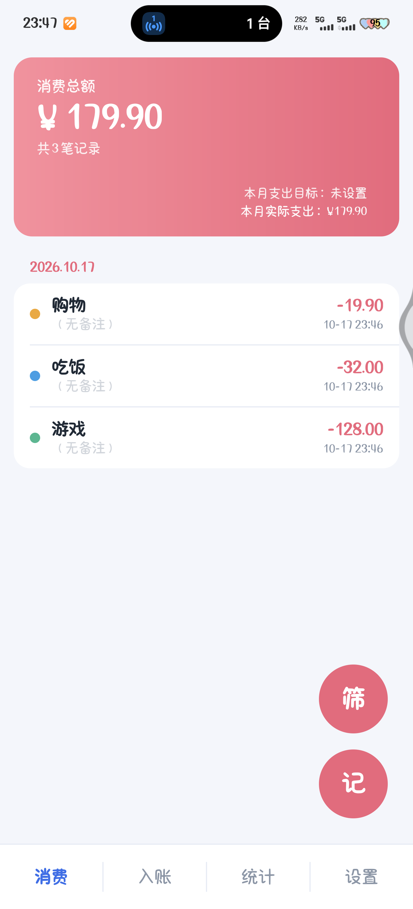
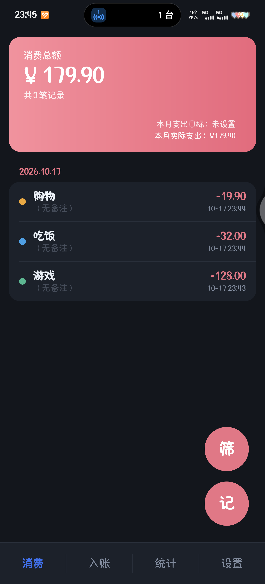
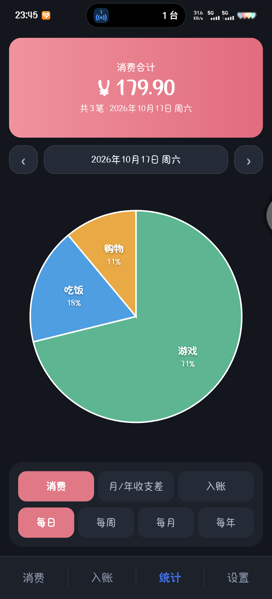
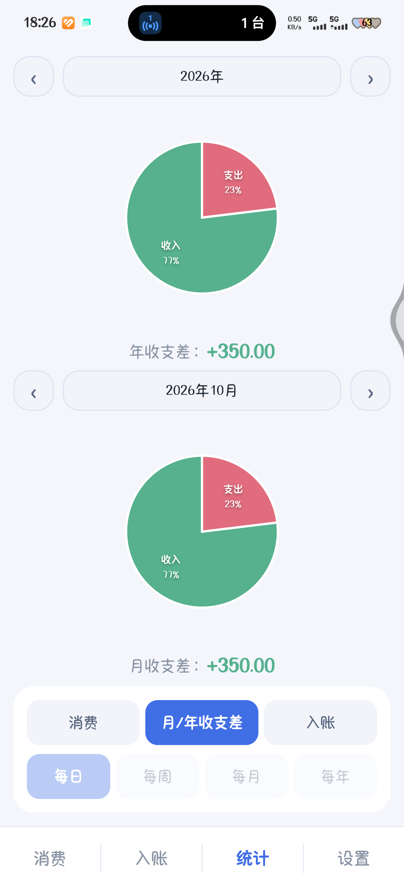

<div align="center">


# 大肥鱼账本

**一个不需要联网、不需要账号、不申请任何运行时权限的安卓记账 App**


[功能](#功能) · [截图](#截图) · [下载安装](#下载安装) · [从源码构建](#从源码构建) · [实现说明](#实现说明) · [已知限制](#已知限制)

</div>

---

## 为什么又写一个记账 App

市面上的记账 App 大多要求注册账号、同步云端、申请一堆权限，还会推送广告。这个项目的出发点很简单：

- **数据只在你手机里**：SQLite 本地存储，App 没有 `INTERNET` 权限，从技术上就传不出去
- **零运行时权限**：不读通讯录、不读短信、不读相册，装完就能用
- **手写 UI**：没有 AndroidX / Material，界面全部用系统 View 加自绘控件实现，安装包不到 1.2 MB
- **不用 Gradle**：`aapt2 + javac + d8 + apksigner` 六个步骤编完，冷启动几秒出包

## 功能

### 消费 / 入账 记账
- 顶部大卡片：左上角是累计总额和笔数，右下角是**本月目标**（可编辑）和**本月实际**（只读，每月 1 号 00:00 自动归零）
- 记录**按天分组**，每天一个日期标题
- 右下角两个悬浮按钮：**筛**（按分类筛选）、**记**（弹出底部「记一笔」面板）
- **多选删除**：长按进入多选，支持全选
- 消费分类：红包、转账、购物、游戏、生活缴费、吃饭、应用会员
- 入账分类：红包、转账、工资、收款
- 每笔都可填备注

### 统计
- **消费 / 入账** 单饼图模式：合计卡 + 日期条 + 2D 饼图 + 控制面板
- 支持 `每日 / 每周 / 每月 / 每年`（每周按周一起算）
- 饼图把**分类名称和占比直接画在扇形内部**，极小扇区自动引线标注到外侧
- **月/年收支差** 模式：上下两张饼图，展示收入与支出的占比，并给出 `年收支差` / `月收支差`（赚了带 `+`、亏了带 `-`，绿/红区分）

### 其它
- **深色模式**：设置页一键切换，立即生效
- **导入账单**：解析微信 / 支付宝导出的 CSV
- **自动记账**：监听支付宝 / 微信的收付款通知，自动记一笔（可选）
- **清空全部数据**

## 截图

| 消费页（浅色） | 消费页（深色） |
| :---: | :---: |
|  |  |

| 统计 · 分类饼图（深色） | 统计 · 月年收支差（浅色） |
| :---: | :---: |
|  |  |

## 下载安装

去本仓库的 **Releases** 页面下载最新的 `DaFeiYuLedger.apk`，传到手机点击安装即可。

- 最低支持 **Android 7.0（API 24）**，编译与测试环境为 Android 16
- APK 用自签名证书，安装时系统会提示「未知来源 / 外部来源应用」，需要允许一次

## 从源码构建

### 环境要求

| 组件 | 版本 | 说明 |
| --- | --- | --- |
| JDK | 11 或 17 | 只用 `javac` / `keytool` |
| Android SDK Platform | `android-35` | 提供 `android.jar` |
| Android SDK Build-Tools | `35.0.0` | 提供 `aapt2` / `d8` / `zipalign` / `apksigner` |
| Python | 3.x | 打包 dex 用的小脚本 |

用 `sdkmanager` 安装：

```bash
sdkmanager "platforms;android-35" "build-tools;35.0.0"
```

### 编译

```bash
export ANDROID_SDK_ROOT=/path/to/android-sdk
./build.sh
```

产物是仓库根目录的 `DaFeiYuLedger.apk`。脚本会依次执行：

```
aapt2 compile → aapt2 link → javac → d8 → 打包 classes.dex → zipalign → apksigner
```

首次编译会自动生成一个自签名密钥库（`keystore/dafeiyu.jks`，密码 `dafeiyu123`），**这个文件不要提交到仓库**（`.gitignore` 已排除）。要换成自己的签名：

```bash
KS_PATH=~/my.jks KS_PASS=yourpass KS_ALIAS=youralias ./build.sh
```

可选环境变量：`ANDROID_PLATFORM`、`BUILD_TOOLS_VERSION`、`QEMU_TOOLS`、`KS_PATH`、`KS_PASS`、`KS_ALIAS`。

### 在 arm64 主机上构建

Google 官方的 `aapt2` / `zipalign` 只提供 **x86_64** 版本。如果你在 arm64 机器（比如 Apple Silicon、树莓派、部分国产开发板）上编译，需要让这两个工具跑在 qemu 用户态模拟里：

```bash
# Ubuntu / Debian
sudo dpkg --add-architecture amd64
sudo apt update
sudo apt install qemu-user-static libc6:amd64 libgcc-s1:amd64
```

然后准备两个包装脚本（`build.sh` 会自动探测 `QEMU_TOOLS` 目录，默认 `/root/tools/bin`）：

```bash
mkdir -p /root/tools/bin
cat > /root/tools/bin/aapt2 <<'EOF'
#!/bin/bash
export QEMU_LD_PREFIX=/
exec /usr/bin/qemu-x86_64-static /path/to/build-tools/35.0.0/aapt2 "$@"
EOF
chmod +x /root/tools/bin/aapt2
# zipalign 同理
```

`d8` 和 `apksigner` 是 Java 程序，不需要模拟。

### 换图标

`make_icons.py` 会把一张正方形原图切成各密度图标、圆形图标和自适应图标：

```bash
python3 make_icons.py && ./build.sh
```

改脚本里的 `SRC`（原图路径）和 `BBOX`（不透明内容的外框）即可。

## 目录结构

```
├── AndroidManifest.xml
├── build.sh                    # 一键编译（不用 Gradle）
├── make_icons.py               # 原图 → 各密度图标 / 自适应图标
├── packapk.py                  # 把 classes.dex 塞进 aapt2 产物
├── docs/                       # README 用的截图
├── res/
│   ├── layout/                 # 5 个页面 + 2 个列表项 + 1 个底部弹层
│   ├── drawable/               # 形状 drawable（渐变头图、圆角卡、FAB）
│   ├── values/                 # 颜色、主题（浅色/深色两套）、自定义属性
│   ├── anim/                   # 底部弹层进出动画
│   └── mipmap-*/               # 图标
└── src/com/dafeiyu/ledger/
    ├── MainActivity.java       # 底部四页导航 + 跨月刷新
    ├── EntryPage.java          # 消费 / 入账页（按天分组、多选、筛选、本月目标）
    ├── EntrySheet.java         # 「记一笔」底部弹层
    ├── StatsPage.java          # 统计页（单饼图 / 双饼图两种模式）
    ├── PieChartView.java       # 2D 饼图自绘控件（内部标注 + 引线标注）
    ├── SettingsPage.java       # 设置页
    ├── PayListener.java        # 通知监听自动记账
    ├── BillImport.java         # 微信 / 支付宝 CSV 解析
    ├── Db.java                 # SQLite 存储与汇总
    ├── Period.java             # 日 / 周 / 月 / 年区间计算
    ├── Cats.java               # 分类定义与配色
    ├── SegBar.java             # 分段选择控件
    ├── FlowLayout.java         # 标签自动换行
    ├── Palette.java            # 主题调色板
    ├── Prefs.java              # 本地偏好
    └── Record.java             # 记录实体
```

## 实现说明

### 数据存储

单表 SQLite：

```sql
CREATE TABLE records (
    id       INTEGER PRIMARY KEY AUTOINCREMENT,
    type     INTEGER NOT NULL,   -- 0 = 消费，1 = 入账
    category TEXT    NOT NULL,
    amount   REAL    NOT NULL,
    note     TEXT    NOT NULL DEFAULT '',
    ts       INTEGER NOT NULL    -- 毫秒时间戳
);
```

汇总直接交给 SQL（`SUM` / `COUNT` / `GROUP BY category`），列表按 `ts DESC` 读取后在内存里按天分组。

### 统计口径

- **每周**：周一到周日
- **每月 / 每年**：自然月 / 自然年
- 区间统一是 `[start, end)`，`Period` 类负责所有时间边界计算
- 「本月实际支出 / 收入」取当前自然月的区间和，所以每月 1 号 0 点自然归零；App 停留在前台跨月时，按「下月 1 号 0 点」定了定时刷新

### 账单导入

不做列序写死，而是**按表头名字识别列**，因此微信、支付宝两种不同格式都能读：

| 字段 | 匹配的表头 |
| --- | --- |
| 时间 | 交易时间 / 付款时间 / 交易创建时间 |
| 金额 | 以「金额」开头的列 |
| 收支 | 收/支、收支、资金状态 |
| 交易对方 | 交易对方、对方账号 |
| 商品 | 商品、商品说明、商品名称 |

另外：

- 支持 UTF-8 / GB18030 自动回退（微信导出的 CSV 常见 GBK）
- 跳过「不计收支」「交易关闭」「已全额退款」
- 按「秒级时间戳 + 金额（分）」去重，同一份账单导两次不会翻倍
- 按「交易对方 + 商品说明 + 备注」关键字猜分类，例如美团/饿了么 → 吃饭、王者荣耀 → 游戏、国家电网 → 生活缴费、腾讯视频/Apple → 应用会员

原始 CSV 若在压缩包里，App 会尝试直接解压；带密码的压缩包需要先手动解压。

### 通知监听自动记账

`PayListener` 继承 `NotificationListenerService`，只处理 `com.eg.android.AlipayGphone` 和 `com.tencent.mm` 的通知：

1. 拼出通知的标题 / 正文 / 大文本 / 多行文本
2. 命中「到账 / 收款 / 已收钱」判为收入，命中「付款 / 支付 / 消费 / 支出 / 扣款」判为支出
3. 用 `([0-9.]+)\s*元` 或 `[¥￥]\s*([0-9.]+)` 抓金额
4. 同金额 15 秒内不重复记账

### 不用 AndroidX 的代价与收益

项目刻意只依赖 Android Framework：

- 收益：APK 小、没有方法数问题、编译不拉网、不会因为依赖升级而炸
- 代价：没有 `RecyclerView`、没有 `ViewBinding`、没有现成的 Material 组件，列表、分段控件、饼图、底部弹层都要自己写

所有自绘控件（`PieChartView`、`SegBar`、`FlowLayout`）都在 `src/` 里，没有几行黑魔法。

## 已知限制

- **微信的通知基本抓不到金额**：微信默认是「N 条新消息」聚合通知，微信支付凭证是公众号聊天消息，不点开就没有内容。支付宝通知通常会带金额，命中率较高
- **小额扇区标注在外侧**：占比小于约 5% 的分类，扇形内部放不下文字，会自动用引线标到饼图外侧
- **没有云同步 / 备份**：换手机需要自己迁移（导出功能还在路线图里）
- **只支持人民币**：金额格式固定为 `¥` 加两位小数
- **不含多账本**：一个 App 一本账

## Roadmap

- [ ] 数据导出（CSV / JSON）与导入恢复
- [ ] 预算超支提醒
- [ ] 桌面小组件（本月支出 / 收支差）
- [ ] 记账时可选日期（补记昨天的账）
- [ ] 多账本 / 账本归档

## 隐私

- 没有 `INTERNET` 权限，App 无法发起任何网络请求
- 没有账号体系，不收集任何设备信息
- 所有账目保存在 App 私有目录的 SQLite 里，卸载即删除
- 通知监听是可选的：需要你在系统「通知使用权」里手动授予，随时可以撤销

## 参与贡献

欢迎提 Issue 和 PR。提交代码前请注意：

- 保持**零第三方依赖**，这是这个项目最重要的约束
- 新增的 UI 请同时适配浅色 / 深色两套主题（颜色统一从 `Palette` 或 `?attr/col*` 取）

## 许可证

[MIT](LICENSE)
